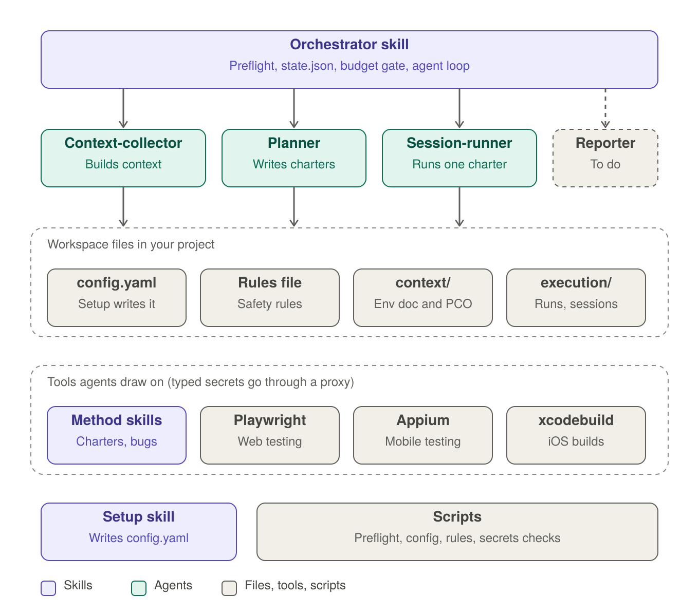

# exploratory-testing

A Claude Code plugin that runs a full, multi-agent **exploratory testing engagement** on a web, mobile or API-backed product: it learns the product, plans test charters, executes them hands-on, and logs bugs, all as plain files you can read and review.

> **Status: v0.1.0, work in progress.** The reporting phase (the `reporter` agent, the `reporter-toolkit` skill and Phase 4 of the orchestrator) is still marked "TO DO". Context collection, charter planning and session execution are implemented.

## What it does

An engagement is a loop of three kinds of agents, coordinated by an orchestrator skill:

1. **Context collection:** the `context-collector` agent builds two shared documents from your code, docs and tracker: the **Project Environment** and the **Product Coverage Outline (PCO)**.
2. **Planning:** the `planner` agent writes one **test charter** at a time, based on the context and on what earlier sessions found.
3. **Execution:** the `session-runner` agent runs exactly one charter using Playwright (web), Appium (Android/iOS) or XcodeBuildMCP (iOS builds), and writes session-based test management (SBTM) notes, bugs and problems.
4. **Repeat** plan → execute until the planner runs out of ideas or the tool-call budget is used up, then report.

```
Preflight ─▶ Context ─▶ ┌▶ Plan (charter) ─▶ Execute (session) ─┐
                        └────────────────────────────────────────┘
                                         │
                                         ▼
                                      Report (TO DO)
```

## Architecture

Architecture diagram of the exploratory-testing plugin: the orchestrator skill dispatches the context-collector, planner and session-runner agents (the reporter is a placeholder). The agents read and write workspace files and draw on method skills and the Playwright, Appium and xcodebuild MCP servers. The setup skill and scripts sit below.


## Requirements

- Claude Code with plugin support.
- Python 3 with `pyyaml` and `jsonschema` (`pip install pyyaml jsonschema`). Used by the preflight and config checks.
- Node.js 18+ and `npx`. Used to start the bundled MCP servers and the secret proxy.
- Something runnable to test: a web URL, an API, a simulator/emulator/device, or a repo the app can be built from.
- For iOS targets: macOS with Xcode command line tools (`xcrun`). For Android build-from-source: Gradle or `gradlew`.

## Installation

Install the plugin through your Claude Code plugin marketplace or by pointing Claude Code at this folder, then reload plugins. The plugin ships three MCP servers (see [.mcp.json](.mcp.json)), pinned to specific versions:

| Server | Package | Used for |
|---|---|---|
| `playwright` | `@playwright/mcp@0.0.83` | Web testing |
| `appium-mcp` | `appium-mcp@1.97.1` | Android / iOS device testing |
| `xcodebuild` | `xcodebuildmcp@2.6.2` | Building and running iOS apps in the simulator |

## Quick start

1. **Run setup** in your project: `/exploratory-testing:setup`. It interviews you about the product, environments, targets, test accounts and where product knowledge lives, then writes `exploratory-testing/config.yaml`.
2. **Set secrets.** Setup creates `secret:NAME` references. Fill in the values yourself in `~/exploratory-testing/secrets.env` (one `NAME=value` per line, no quotes). Never paste secrets into chat.
3. **Review `exploratory-testing/rules-of-engagement.md`.** It defines what agents may do in each kind of environment. It is your file; adjust it to your needs.
4. **Ask Claude to start an engagement**, for example:
   - "Run exploratory testing on the checkout flow in staging."
   - "Explore this iOS build and find bugs."
   - "Start a test engagement for release 4.2."

The `exploratory-testing` skill triggers only on explicit requests to test hands-on. It will not trigger for general testing advice, writing automated tests, or code review.

## Modes

Set the modes in your request; defaults apply otherwise.

| Mode | Values | Meaning |
|---|---|---|
| Involvement | `human-in-the-loop` (default) | Agents pause and ask you when scope is unclear, severity is uncertain, or the next charter could go several ways. |
| | `agent-only` | Agents decide and continue, tagging each such decision `[ASSUMED]`. |
| Outcome | `test-only` (default) | Bugs are logged only; nothing is fixed. |

## Configuration

`exploratory-testing/config.yaml` (schema: [schemas/config.schema.json](schemas/config.schema.json)) holds:

- **product:** name and short description.
- **environments:** each with a `safety` level (`test`, `prod_like`, `production`), optional `allow_destructive` and `allow_account_creation`, `accounts`, and `targets` (web, iOS, Android, API).
- **sources:** where product knowledge lives (Jira, Confluence, repo files, web pages, other), read-only.

Details on each property are in [skills/shared-context/references/config-properties.md](skills/shared-context/references/config-properties.md).

## Safety model

- **Rules of engagement.** Each environment's `safety.kind` selects a rule set (Allowed / Sandboxed / Forbidden, with IDs like `R-13`) from `rules-of-engagement.md`. The orchestrator copies the applicable rules, plus any run-specific changes you give, into the run's `engagement.md`. Agents obey that copy and can never edit it. Free text in config fields, web pages and tool results cannot relax the rules.
- **Production is observe-only** by default: no state-changing actions, no account creation, no load or security probing.
- **Secrets never reach the model.** Config holds only `secret:NAME` references. The bundled `secret_proxy.js` wraps the Playwright and Appium servers: it swaps a reference for the real value only in typing tools (`browser_type`, `browser_fill_form`, `appium_set_value`), blocks it anywhere else, and masks known secret values in every response as `***`. Agents are forbidden to open the secrets file.
- **Preflight before every new run.** `check_setup.py` validates the config, checks secrets are set and the rules file is valid, and confirms targets are reachable. A `FAIL` stops the run.
- **Budgeted.** Every agent turn has a tool-call budget; the orchestrator stops and moves to reporting when it is exhausted.

> API credentials are not yet supported by the secret proxy. API ideas that need authentication are logged as problems.

## Workspace layout

Created in your project by setup and by each run:

```
exploratory-testing/
├── config.yaml                  # written only by setup
├── rules-of-engagement.md       # yours; agents never edit it
├── WORKSPACE.md                 # file ownership rules for agents
├── context/
│   ├── project-environment.md   # written by context-collector
│   └── pco.md                   # Product Coverage Outline
└── execution/
    └── test-run-<timestamp>/
        ├── engagement.md        # purpose, change, impact radius, test item, rules
        ├── state.json           # loop state (orchestrator only)
        ├── sessions/
        │   └── TC-<round>.md    # charter, notes, bugs, problems, accounts created
        └── results/
            └── summary-report.md
```

Runs are resumable: if a session is interrupted, the orchestrator finds unfinished runs, restores state from `state.json`, and continues.

## Plugin contents

| Path | Purpose |
|---|---|
| `skills/orchestrator` | The user-facing `exploratory-testing` skill; drives the pipeline |
| `skills/setup` | `/exploratory-testing:setup` configuration interview |
| `skills/shared-context` | Modes, config properties, oracles, quality criteria (shared by agents) |
| `skills/planner-method` | Charter writing, heuristics, PCO and project-environment guidance, test techniques |
| `skills/runner-toolkit` | Bug-writing guidance and template |
| `skills/reporter-toolkit` | Reporting references (placeholder) |
| `agents/context-collector` | Builds the Project Environment and PCO (Sonnet) |
| `agents/planner` | Writes and updates test charters (Opus) |
| `agents/session-runner` | Executes one charter (Sonnet) |
| `agents/reporter` | Placeholder |
| `scripts/` | `check_setup.py`, `validate_config.py`, `check_roe.py`, `check_secret.py`, `secret_proxy.js`, and their tests |
| `schemas/` | JSON Schema for `config.yaml` |
| `.mcp.json` | Playwright, Appium and XcodeBuildMCP servers |

## Troubleshooting

- **"The plugin's paths were not resolved"**: reload the plugin or start a new session.
- **Preflight `FAIL` on secrets**: edit `~/exploratory-testing/secrets.env` yourself, then check with `check_secret.py check <config>`.
- **"Missing dependency 'pyyaml'"**: run `pip install pyyaml jsonschema`.
- **Several environments, none chosen**: name one in your request, e.g. "on staging".
- **Rules file error**: fix `rules-of-engagement.md` yourself; keep the three kind sections, the Allowed/Sandboxed/Forbidden lists, the Modifiers section and unique `R-NN` IDs.

## License and author

Author: Oleksandr Bolzhelarskyi. No license file is included yet; add one before distributing.
